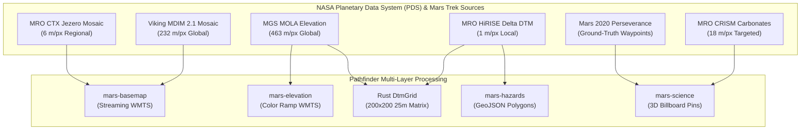

# MARS PATHFINDER — Dataset Provenance, Spatial CRS & Uncertainty Register

**Document Identifier:** MARS-PF-2026-DATA-001  
**Version:** 1.0.0  
**Cartographic Standard:** Planetary Data System (PDS4) / IAU 2015 Cartographic Standards  
**Target Geodetic Datum:** Mars IAU 2015 Triaxial Ellipsoid (`IAU_2015:49900`) & MOLA Areoid Elevation Datum  
**Document Status:** Approved Data Provenance Register  

---

## 1. Cartographic Reference Frames & Coordinate Systems

### 1.1 Planetary Reference Ellipsoid
All geospatial coordinates and distances in MARS PATHFINDER are strictly referenced to the **International Astronomical Union (IAU) 2015 Mars System**:
* **Authority Identifier:** `IAU_2015:49900`
* **Latitude Type:** Planetocentric Latitude ($\phi$), defined as the angle between the equatorial plane and a line drawn from the planetary center of mass to the point on the surface.
* **Longitude Direction:** East-Positive Longitude ($\lambda$), ranging continuously from $0^\circ$ to $360^\circ$ (or $-180^\circ$ to $+180^\circ$).
* **Semi-Major Axis ($a$):** $3,396,190.0\text{ m}$
* **Semi-Minor Axis ($b$):** $3,376,200.0\text{ m}$
* **Inverse Flattening ($1/f$):** $169.894447$

### 1.2 Vertical Datum (The Martian Areoid)
Topographic elevations on Mars are measured relative to the **MOLA Areoid (Geoid)**:
* **Datum Definition:** An equipotential gravitational surface whose average radius at the equator equals the reference radius of $3,396,000.0\text{ m}$.
* **Significance in Jezero:** The floor of Jezero Crater lies inside an ancient impact basin, resulting in negative elevations ranging from $-2,568.4\text{ m}$ at the delta bottomsets to $-2,412.1\text{ m}$ at the western delta apex.

---

## 2. Ingested Dataset Provenance Register (Blueprint Section 4)

### 2.1 Register Table

| Dataset ID | Official Dataset Title | Spacecraft & Instrument | Ground Sampling Distance | Spatial Coverage | PDS Product ID & Source URL | Cartographic CRS | Known Artifacts & Limitations | Uncertainty Handling in Pathfinding |
| :--- | :--- | :--- | :--- | :--- | :--- | :--- | :--- | :--- |
| **DS-01** | **Viking Orbiter MDIM 2.1 Colorized Mosaic** | Viking Orbiter 1 & 2 Visual Imaging Subsystem (VIS) | $232.0\text{ m/px}$ | Global Mars ($100\%$) | `VO_MDIM_21_GLOBAL` [NASA Trek](https://trek.nasa.gov/mars/) | `IAU_2015:49900` | Coarse resolution; radiometric seams; shadowed crater rims; imprecise for ground hazard analysis. | Regional context basemap only. Overridden by CTX and HiRISE within the Jezero pilot region. |
| **DS-02** | **MRO CTX Jezero Crater Mosaic** | Mars Reconnaissance Orbiter (MRO) Context Camera (CTX) | $6.0\text{ m/px}$ | Jezero Crater & Nili Fossae ($18^\circ\text{–}19^\circ\text{N}$, $77^\circ\text{–}78^\circ\text{E}$) | `MurrayLab_CTX_V01_Jezero` [Caltech Murray Lab](http://murray-lab.caltech.edu/CTX/) | `IAU_2015:49900` (Equirectangular) | Solar illumination variation between orbital passes; seasonal atmospheric dust haze. | Provides high-fidelity surface imagery draped over terrain; used to visually contextualize route corridors. |
| **DS-03** | **MRO HiRISE Jezero Crater Western Delta DTM** | High Resolution Imaging Science Experiment (HiRISE) | $1.0\text{ m/px}$ (DTM post-spacing) | Western Delta & Fan ($18.41^\circ\text{–}18.49^\circ\text{N}$, $77.40^\circ\text{–}77.50^\circ\text{E}$) | `DTEEC_045994_1985_046060_1985_A01` [HiRISE PDS](https://www.uahirise.org/dtm/dtm.php?ID=ESP_045994_1985) | `IAU_2015:49900` (Transverse Mercator clamped to Aeroid) | Photogrammetric correlation gaps on featureless dune crests; steep escarpment shadowing. | **Primary substrate for Horn's slope derivation.** Assigned maximum confidence ($U=0.0$). Zero uncertainty penalty. |
| **DS-04** | **MGS MOLA Megascience Elevation Model (MEGDR)** | Mars Global Surveyor (MGS) Mars Orbiter Laser Altimeter (MOLA) | $463.0\text{ m/px}$ ($128\text{ pixels/degree}$) | Global Mars ($100\%$) | `MGS-M-MOLA-5-MEGDR-L3-V1.0` [PDS Geosciences](https://pds-geosciences.wustl.edu/missions/mgs/mola.html) | `IAU_2015:49900` (Aeroid Datum) | Very coarse footprint ($463\text{ m}$); completely misses meter-scale boulder clusters and scarps. | Outside HiRISE coverage, terrain uncertainty $U(v) = 1.0$. Incurs high penalty $w_u \cdot 1.0$ to steer routes into HiRISE coverage. |
| **DS-05** | **MRO CRISM Targeted Mineralogy Cube** | Compact Reconnaissance Imaging Spectrometer for Mars (CRISM) | $18.0\text{–}36.0\text{ m/px}$ | Targeted Jezero deltaic margin ($18.46^\circ\text{N}, 77.42^\circ\text{E}$) | `FRT00005C5E_07_IF166L_TRR3` [CRISM PDS](https://crism.jhuapl.edu/) | `IAU_2015:49900` | Atmospheric $\text{CO}_2$ absorption bands; column striping; detector cryocooler thermal drift. | Delineates high-priority science waypoints (Mg-carbonates and clay units) for mission traversal objectives. |
| **DS-06** | **Mars 2020 Perseverance Traverse & Target Log** | Mars 2020 Rover Avionics / Navcam / Hazcam / PIXL / SHERLOC | Ground Truth ($<0.01\text{ m}$) | Jezero Floor to Delta Apex ($18.44^\circ\text{–}18.47^\circ\text{N}$, $77.40^\circ\text{–}77.46^\circ\text{E}$) | `M2020_TRAVERSE_SOL_0001_1000` [JPL Mars 2020](https://mars.nasa.gov/mars2020/) | `IAU_2015:49900` | Ground track limited to traversed path; does not cover unvisited northern and southern fan margins. | Verified ground-truth waypoints (Octavia E. Butler, Three Forks Sample Depot, Kodiak Butte). |

---

## 3. Spatial Uncertainty Modeling & Routing Penalty

### 3.1 The Spatial Resolution Gap
A central reality of planetary exploration is the heterogeneous resolution of orbital sensors:
* **HiRISE DTM:** Resolves $1.0\text{ m}$ surface features, accurately mapping meter-scale rocks and acute scarp drops.
* **MOLA Global Grid:** Averaged over $463\text{ m}$ footprints. A steep $25^\circ$ cliff spanning $50\text{ m}$ is entirely smoothed over by MOLA, registering as a gentle, passable slope.

### 3.2 Formal Uncertainty Penalty Function ($U(v)$)
To prevent the pathfinding engine from routing an astronaut or rover across unverified, potentially fatal hazards in low-resolution terrain, each grid cell $v$ is assigned an uncertainty value $U(v) \in [0.0, 1.0]$:

$$U(v) = \begin{cases} 0.0 & \text{if cell } v \text{ lies within verified HiRISE DTM footprint} \\ 0.35 & \text{if cell } v \text{ lies within CTX stereo coverage} \\ 1.0 & \text{if cell } v \text{ relies solely on coarse MOLA interpolation} \end{cases}$$

In the cost equation:
$$\text{Cost}(u, v) = d_{\text{3D}}(u, v) \cdot \Big( \alpha_{\text{uphill}} + w_s (\text{slope}/\theta_{\max})^2 + w_h H(v) + \mathbf{w_u U(v)} \Big)$$

* With default weight $w_u = 4.0$, stepping into a coarse MOLA cell multiplies the step cost by an additional $+4.0\times$ distance penalty.
* **Operational Outcome:** The pathfinding algorithm actively detours around coarse, unmapped regions to remain within the safety of high-confidence HiRISE coverage, even if the straight-line distance through the unmapped zone appears shorter.
* **Hard Barrier Threshold:** When the explorer selects the "Minimum Risk / High Certainty" preset ($w_u = 8.0$), any cell with $U(v) \ge 0.99$ becomes a hard exclusion ($\text{Cost} = +\infty$), forbidding traversals across unmapped terrain.
