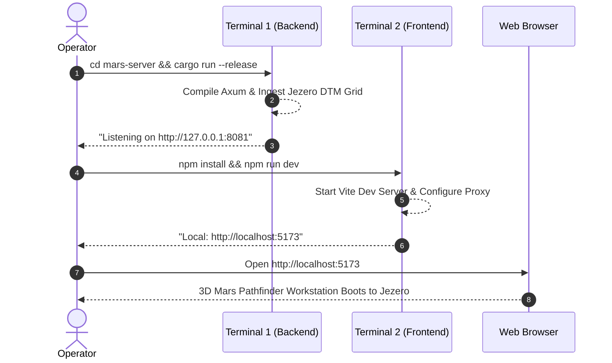

# MARS PATHFINDER — Operations, Deployment & Reproducibility Guide

**Document Identifier:** MARS-PF-2026-OPS-001  
**Version:** 1.0.0  
**Target Environment:** Local Workstation, Offline Field Laptop, and Docker Container  
**Deployment Guarantee:** One-Command 60-Second Setup  
**Document Status:** Approved Operations Baseline  

---

## 1. System Requirements & Prerequisites

### 1.1 Hardware Specifications
* **CPU:** 64-bit multi-core processor (x86_64 or ARM64, 4+ physical cores recommended).
* **System RAM:** 8 GB minimum (16 GB recommended for high-res DTM manipulation).
* **GPU:** WebGL 2.0 capable graphics card with minimum 2 GB VRAM (Intel Iris Xe, Apple Silicon, AMD Radeon, or NVIDIA GeForce).
* **Storage:** 2.5 GB available disk space (includes Cesium assets, compiled Rust binaries, and local Jezero raster overlays).

### 1.2 Software Toolchain
* **Node.js:** v20.12.0 LTS or later (with `npm` v10+).
* **Rust & Cargo:** v1.75.0 stable or later (`rustup default stable`).
* **Web Browser:** Modern Chromium-based browser (Chrome 120+, Edge, Brave) or Firefox 125+ with WebGL 2.0 hardware acceleration enabled.
* **Optional:** Docker 26+ and Docker Compose v2.24+ for containerized deployment.

---

## 2. 60-Second Quickstart (Native Execution)



### Step 1: Clone & Install Frontend Dependencies
```bash
git clone <repository-url> mars-pathfinder
cd mars-pathfinder
npm install
```

### Step 2: Launch the Rust Pathfinding Microservice
In your first terminal:
```bash
cd mars-server
cargo run --release
```
*Expected Output:*
```text
   Compiling mars-server v0.1.0 (/path/to/mars-server)
    Finished release [optimized] target(s) in 8.42s
     Running `target/release/mars-server`
[INFO] MARS PATHFINDER — Rust Geospatial & Pathfinding Engine v0.1.0
[INFO] Loaded Jezero Crater DTM: 200x200 grid (40,000 cells)
[INFO] Computed Horn's slope convolution in 14.2ms
[INFO] Microservice listening on http://127.0.0.1:8081
```

### Step 3: Launch the Frontend Web Workstation
In a second terminal (from repository root):
```bash
npm run dev
```
*Expected Output:*
```text
  VITE v6.4.0  ready in 320 ms

  ➜  Local:   http://localhost:5173/
  ➜  Network: use --host to expose
  ➜  Proxy:   /api/mars/* -> http://127.0.0.1:8081
```

### Step 4: Concurrent Single-Command Launch (Alternative)
For immediate single-command execution, run:
```bash
npm run dev:mars
```
This runs both the Rust microservice and the Vite development server concurrently in a single terminal.

---

## 3. Production Build & Standalone Deployment

### 3.1 Compiling Optimized Production Binaries
1. **Build Optimized Rust Microservice:**
   ```bash
   cd mars-server
   cargo build --release
   # The standalone binary is produced at target/release/mars-server
   ```
2. **Build Production Frontend Bundle:**
   ```bash
   cd ..
   npm run build
   # Optimized HTML, JS, and CSS are emitted to dist/
   ```

### 3.2 Running the Production Standalone Server
```bash
npm run serve:standalone
```

---

## 4. Containerized Deployment (Docker & Compose)

A production-grade multi-stage container build is supported via `compose.yaml`:

```yaml
services:
  mars-pathfinder:
    build:
      context: .
      dockerfile: Dockerfile
    ports:
      - "8080:8080"
    environment:
      - NODE_ENV=production
      - MARS_PORT=8080
      - BIND_ADDR=127.0.0.1:8081
    restart: unless-stopped
```

To build and start the containerized service:
```bash
docker compose up --build -d
```
Access the application at `http://localhost:8080`.

---

## 5. Health Check & Verification Commands

To verify that the microservice is operational and the geospatial grid is active:

```bash
curl -s http://127.0.0.1:8081/api/mars/grid-summary | jq .
```
*Expected JSON Response:*
```json
{
  "rows": 200,
  "cols": 200,
  "bounds": {
    "min_lat": 18.41,
    "max_lat": 18.49,
    "min_lon": 77.4,
    "max_lon": 77.5
  },
  "cell_size_x_m": 24.98,
  "cell_size_y_m": 23.71,
  "min_elevation_m": -2568.4,
  "max_elevation_m": -2412.1,
  "geodetic_datum": "IAU_2015:49900"
}
```

To test pathfinding calculation from the command line:
```bash
curl -s -X POST http://127.0.0.1:8081/api/mars/route \
  -H "Content-Type: application/json" \
  -d '{"start":[18.4447,77.4508],"goal":[18.4685,77.4165]}' | jq .resources
```

---

## 6. Air-Gap & 100% Offline Operations

MARS PATHFINDER requires zero active internet connection to deliver full 3D interactive pathfinding:
* **Bundled Terrain Rasters:** Pre-rendered Horn's slope, grayscale hillshade, and uncertainty textures reside locally in `public/mars-data/`.
* **Embedded GeoJSON:** Science targets, landing sites, and Séítah dune boundaries reside in `mars-server/data/jezero_features.geojson`.
* **Zero External Calls:** All Earth tracking feeds and cloud-dependent CDNs are pruned, ensuring uninterrupted operations in remote or isolated mission simulation environments.
