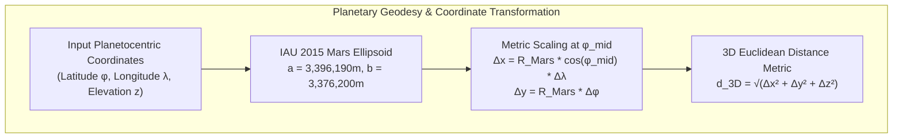
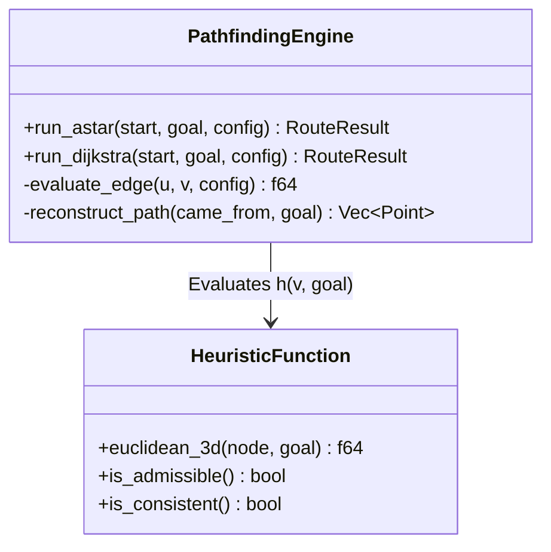

# MARS PATHFINDER — Mathematical & Algorithmic Pathfinding Specification

**Document Identifier:** MARS-PF-2026-MATH-001  
**Version:** 1.0.0  
**Domain:** Planetary Geodesy, Digital Terrain Analysis, Graph Theory, and Astronaut Bioenergetics  
**Target Architecture:** Rust Compute Engine (`mars-server`)  
**Document Status:** Approved Mathematical Baseline  

---

## 1. Planetary Geodesy & Metric Metric Foundations

### 1.1 IAU 2015 Mars Triaxial Ellipsoid
Traditional geospatial software relies on terrestrial WGS84 parameters ($a = 6,378,137\text{ m}$), which severely corrupt Martian surface metrics. MARS PATHFINDER is mathematically anchored to the **IAU 2015 Mars Ellipsoid (`IAU_2015:49900`)**:
* **Equatorial Semi-Major Axis ($a$):** $3,396,190.0\text{ m}$
* **Polar Semi-Minor Axis ($b$):** $3,376,200.0\text{ m}$
* **Mars Mean Volumetric Radius ($R_{\text{Mars}}$):** $3,389,500.0\text{ m}$
* **Flattening Factor ($f$):** $f = \frac{a - b}{a} = \frac{19990.0}{3396190.0} \approx 0.005886007$

### 1.2 Mars Spherical Metric Cell Delta Scaling
For any step between adjacent grid nodes $u = (r_1, c_1)$ and $v = (r_2, c_2)$ on the regular Jezero DTM lattice:
1. Determine planetocentric angular coordinates:
   $$\phi_1 = \text{lat}_{\max} - r_1 \Delta\phi_{\text{rad}}, \quad \phi_2 = \text{lat}_{\max} - r_2 \Delta\phi_{\text{rad}}$$
   $$\lambda_1 = \text{lon}_{\min} + c_1 \Delta\lambda_{\text{rad}}, \quad \lambda_2 = \text{lon}_{\min} + c_2 \Delta\lambda_{\text{rad}}$$
2. Compute mid-latitude:
   $$\phi_{\text{mid}} = \frac{\phi_1 + \phi_2}{2}$$
3. Compute planar surface metric increments using Martian radius:
   $$\Delta x = |c_2 - c_1| \cdot a \cdot \cos(\phi_{\text{mid}}) \cdot \Delta\lambda_{\text{rad}}$$
   $$\Delta y = |r_2 - r_1| \cdot a \cdot \Delta\phi_{\text{rad}}$$
4. Incorporate DTM elevation change $\Delta z = z_v - z_u$:
   $$d_{\text{3D}}(u, v) = \sqrt{\Delta x^2 + \Delta y^2 + (z_v - z_u)^2}$$

### 1.3 Distortion Analysis: Earth WGS84 vs. Mars IAU 2015
Applying terrestrial WGS84 parameters to Mars introduces a catastrophic scale distortion:

$$\text{Distortion Ratio} = \frac{a_{\text{WGS84}}}{a_{\text{Mars}}} = \frac{6,378,137.0\text{ m}}{3,396,190.0\text{ m}} \approx 1.878026 \implies \mathbf{+87.8\% \text{ Error}}$$

* **Consequence on Distance:** A $1,000\text{ m}$ traverse across Jezero Crater would be erroneously calculated as $1,878\text{ m}$, corrupting astronaut life-support calculations by nearly $2\times$.
* **Consequence on Slopes:** Because $\Delta x$ and $\Delta y$ would be artificially inflated by $1.878\times$ while $\Delta z$ (elevation difference) remains constant, slopes would be underestimated by:
  $$\tan(\theta_{\text{err}}) = \frac{\Delta z}{1.878 \cdot \Delta d_{\text{horizontal}}} \approx 0.532 \cdot \tan(\theta_{\text{true}})$$
  A dangerously steep $22^\circ$ scarp would register as only $\sim 12.3^\circ$, leading an automated rover or astronaut directly into an impassable rollover hazard.

---

## 2. Terrain Gradient & Slope Analysis (Horn's Method)

### 2.1 Horn's $3\times3$ Finite-Difference Kernel
To ensure robust, noise-resistant slope calculations across the $200 \times 200$ Jezero DTM elevation grid, we implement **Horn's weighted $3\times3$ finite-difference stencil**.

For cell $(r, c)$ surrounded by its 8 immediate neighbors:

$$\begin{bmatrix} z(r-1, c-1) & z(r-1, c) & z(r-1, c+1) \\ z(r, c-1) & z(r, c) & z(r, c+1) \\ z(r+1, c-1) & z(r+1, c) & z(r+1, c+1) \end{bmatrix} = \begin{bmatrix} z_{00} & z_{01} & z_{02} \\ z_{10} & z_{11} & z_{12} \\ z_{20} & z_{21} & z_{22} \end{bmatrix}$$

The east-west partial derivative $p = \frac{\partial z}{\partial x}$ and north-south partial derivative $q = \frac{\partial z}{\partial y}$ are computed as:

$$p = \frac{(z_{02} + 2z_{12} + z_{22}) - (z_{00} + 2z_{10} + z_{20})}{8 \Delta x}$$

$$q = \frac{(z_{20} + 2z_{21} + z_{22}) - (z_{00} + 2z_{01} + z_{02})}{8 \Delta y}$$

The magnitude of the maximum surface gradient is:

$$\nabla z = \sqrt{p^2 + q^2}$$

The local surface slope angle in radians and degrees:

$$\theta_{\text{rad}} = \arctan(\nabla z), \quad \theta_{\text{deg}} = \theta_{\text{rad}} \cdot \frac{180.0}{\pi}$$

### 2.2 Boundary Cell Handling
For border cells ($r=0$, $r=\text{rows}-1$, $c=0$, $c=\text{cols}-1$), missing neighbor values are synthesized using **reflective Neumann boundary clamping**:
$$z(-1, c) = z(0, c), \quad z(\text{rows}, c) = z(\text{rows}-1, c)$$
This prevents edge artifacts and preserves numerical stability across the pilot boundary.

---

## 3. Mathematical Cost Model for Martian Traversals

### 3.1 Step Cost Equation
For a directed step from node $u$ to adjacent node $v$:

$$\text{Cost}(u, v) = d_{\text{3D}}(u, v) \cdot \left( \alpha_{\text{uphill}}(u, v) + w_s \left(\frac{\text{slope}(v)}{\theta_{\max}}\right)^2 + w_h H(v) + w_u U(v) \right)$$

Where:
* $d_{\text{3D}}(u, v)$: 3D Euclidean step distance in meters.
* $\alpha_{\text{uphill}}(u, v)$: Asymmetric metabolic/mechanical uphill climbing multiplier.
* $\text{slope}(v)$: Horn's slope steepness at target cell $v$ (degrees).
* $\theta_{\max}$: Configurable maximum allowable traversable slope (e.g., $18.0^\circ$).
* $w_s$: Slope penalty weighting coefficient (default: $3.5$).
* $H(v) \in [0.0, 1.0]$: Mapped terrain hazard intensity (e.g., *Séítah* sand dunes or dense boulder clusters).
* $w_h$: Hazard penalty weighting coefficient (default: $6.0$).
* $U(v) \in [0.0, 1.0]$: Spatial uncertainty rating ($0.0$ for HiRISE $1\text{ m/px}$, $1.0$ for coarse MOLA $463\text{ m/px}$).
* $w_u$: Uncertainty penalty weighting coefficient (default: $4.0$).

### 3.2 Asymmetric Uphill Penalty Factor ($\alpha_{\text{uphill}}$)
Climbing against Martian gravity ($g_{\text{Mars}} = 3.72076\text{ m/s}^2$) requires significant metabolic work for an EVA astronaut and high motor torque for a rover. Conversely, descending or walking on flat terrain incurs minimal additional gravitational work:

$$\alpha_{\text{uphill}}(u, v) = 1.0 + 2.5 \cdot \frac{\max(0.0, \, z_v - z_u)}{d_{\text{3D}}(u, v)}$$

* **Flat Traversal ($z_v = z_u$):** $\alpha_{\text{uphill}} = 1.0$.
* **Downhill Traversal ($z_v < z_u$):** $\max(0.0, z_v - z_u) = 0.0 \implies \alpha_{\text{uphill}} = 1.0$.
* **Steep Uphill Traversal ($z_v - z_u > 0$):** Since $\frac{\Delta z}{d_{\text{3D}}} = \sin(\theta)$, $\alpha_{\text{uphill}} = 1.0 + 2.5 \sin(\theta) \in [1.0, 3.5]$.
* **Operational Implication:** Because $\alpha_{\text{uphill}}(u, v) \neq \alpha_{\text{uphill}}(v, u)$, **the graph is inherently directed and asymmetric**. The optimal return route from Destination $\to$ Start can take a completely different geographical path than the Outbound leg, navigating gentler ridgelines to minimize cumulative elevation gain!

### 3.3 Hard Exclusion Barriers (Impassable Terrain)
To guarantee astronaut and rover survival, hard physical exclusions override the continuous cost function:

$$\text{If } \Big( \text{slope}(v) > \theta_{\max} \;\lor\; H(v) \ge 0.99 \;\lor\; U(v) \ge 0.99 \Big) \implies \text{Cost}(u, v) = +\infty$$

Any cell satisfying these criteria is immediately pruned and excluded from insertion into the pathfinding priority queue, ensuring paths never skirt dangerous cliff faces or enter active sand traps.

---

## 4. Algorithmic Formulation & Proof of Admissibility

### 4.1 $A^*$ Graph Search Algorithm
1. Initialize min-priority queue $Q$ with starting node $u_{\text{start}}$, with priority $f(u_{\text{start}}) = 0.0 + h(u_{\text{start}}, \text{goal})$.
2. Maintain hash tables `g_score` mapping node index to lowest observed cost from start, and `came_from` mapping node index to predecessor.
3. While $Q \neq \emptyset$:
   * Pop node $u$ with lowest $f(u) = g(u) + h(u, \text{goal})$.
   * If $u = \text{goal}$, terminate and reconstruct optimal path.
   * If $g(u) > \text{g\_score}[u]$, continue (stale heap entry).
   * For each valid 8-connected neighbor $v \in \text{Neighbors}(u)$:
     * If $\text{Cost}(u, v) = +\infty$, skip.
     * Tentative cost $g_{\text{tentative}} = g(u) + \text{Cost}(u, v)$.
     * If $g_{\text{tentative}} < \text{g\_score}[v]$:
       * $\text{g\_score}[v] \leftarrow g_{\text{tentative}}$.
       * $\text{came\_from}[v] \leftarrow u$.
       * Push $(g_{\text{tentative}} + h(v, \text{goal}), v)$ into $Q$.

### 4.2 Proof of $A^*$ Admissibility
**Theorem:** *The 3D Euclidean distance heuristic $h(v, \text{goal}) = d_{\text{3D}}(v, \text{goal})$ is strictly admissible.*

**Proof:**
1. A heuristic $h(v)$ is admissible if $\forall v, \; h(v) \le h^*(v)$, where $h^*(v)$ is the true optimal remaining cost from $v$ to $\text{goal}$.
2. The true optimal cost along any sequence of edges $\langle v_0 = v, v_1, \dots, v_k = \text{goal} \rangle$ is:
   $$C^* = \sum_{i=0}^{k-1} \text{Cost}(v_i, v_{i+1})$$
3. By definition of the step cost function:
   $$\text{Cost}(v_i, v_{i+1}) = d_{\text{3D}}(v_i, v_{i+1}) \cdot \left( \alpha_{\text{uphill}} + w_s \left(\frac{\text{slope}}{\theta_{\max}}\right)^2 + w_h H + w_u U \right)$$
4. Since $\alpha_{\text{uphill}} \ge 1.0$ and $w_s, w_h, w_u \ge 0$, the scalar factor in parentheses is $\ge 1.0$ everywhere.
5. Therefore:
   $$\text{Cost}(v_i, v_{i+1}) \ge d_{\text{3D}}(v_i, v_{i+1})$$
6. Summing over the path:
   $$C^* \ge \sum_{i=0}^{k-1} d_{\text{3D}}(v_i, v_{i+1})$$
7. By the triangle inequality in 3D Euclidean space:
   $$\sum_{i=0}^{k-1} d_{\text{3D}}(v_i, v_{i+1}) \ge d_{\text{3D}}(v, \text{goal})$$
8. Hence:
   $$h^*(v) \ge d_{\text{3D}}(v, \text{goal}) = h(v, \text{goal})$$
9. Since $h(v, \text{goal}) \le h^*(v)$ for all $v$, the heuristic never overestimates the true remaining cost.  
$\mathbf{Q.E.D.}$

### 4.3 Proof of $A^*$ Consistency (Monotonicity)
**Theorem:** *The heuristic $h(v, \text{goal}) = d_{\text{3D}}(v, \text{goal})$ is consistent (monotonic).*

**Proof:**
1. Consistency requires that for every transition $(u, v)$:
   $$h(u) \le \text{Cost}(u, v) + h(v)$$
2. Rearranging terms:
   $$h(u) - h(v) = d_{\text{3D}}(u, \text{goal}) - d_{\text{3D}}(v, \text{goal})$$
3. By the triangle inequality:
   $$d_{\text{3D}}(u, \text{goal}) - d_{\text{3D}}(v, \text{goal}) \le d_{\text{3D}}(u, v)$$
4. From step 5 above, $d_{\text{3D}}(u, v) \le \text{Cost}(u, v)$.
5. Therefore:
   $$h(u) - h(v) \le \text{Cost}(u, v) \iff h(u) \le \text{Cost}(u, v) + h(v)$$
6. Since $h$ is consistent, $A^*$ is guaranteed to find the optimal path without ever reopening a closed node.  
$\mathbf{Q.E.D.}$

### 4.4 Dijkstra Baseline Equivalence
When $h(v, \text{goal}) \equiv 0.0$, the algorithm reduces to Dijkstra's uniform-cost search. Because $h$ is admissible and consistent:

$$\text{OptimalCost}(A^*) \equiv \text{OptimalCost}(\text{Dijkstra})$$

Our automated verification test asserts $|\text{Cost}_{A^*} - \text{Cost}_{\text{Dijkstra}}| < 10^{-5}$ across all test cases.

---

## 5. EVA Life Support & Consumables Model

### 5.1 Astronaut Mobility & Temporal Equations
* **Base Walking Velocity:** $v_{\text{walk}} = 2.4\text{ km/h} \approx 0.6667\text{ m/s}$ (standard pressurized spacesuit gait in $0.38\text{ g}$).
* **Target Science Investigation Time:** $t_{\text{sci}} = 0.5\text{ hr} = 30\text{ min}$ (field sampling and spectroscopy).
* **Traverse Durations:**
  $$t_{\text{out}} = \frac{d_{\text{out}}}{v_{\text{walk}} \cdot 1000} \text{ [hr]}, \quad t_{\text{ret}} = \frac{d_{\text{ret}}}{v_{\text{walk}} \cdot 1000} \text{ [hr]}$$
  $$t_{\text{total}} = t_{\text{out}} + t_{\text{ret}} + t_{\text{sci}} \text{ [hr]}$$

### 5.2 Consumables Depletion Equations
1. **Primary Spacesuit Oxygen ($\text{O}_2$) Consumption:**
   * Nominal Metabolic Consumption Rate: $r_{\text{O2}} = 1.1\text{ L/min}$ ($66.0\text{ L/hr}$).
   * Total Tank Capacity: $V_{\text{cap}} = 550.0\text{ L}$.
   * Required Oxygen Volume:
     $$V_{\text{req}} = r_{\text{O2}} \cdot (t_{\text{total}} \cdot 60) \text{ [L]}$$
2. **Spacesuit Avionics & Thermal Battery Power Draw:**
   * Average System Power Draw: $P_{\text{suit}} = 130.0\text{ Wh/hr}$.
   * Total Battery Pack Capacity: $E_{\text{cap}} = 850.0\text{ Wh}$.
   * Required Electrical Energy:
     $$E_{\text{req}} = P_{\text{suit}} \cdot t_{\text{total}} \text{ [Wh]}$$

### 5.3 Safety Margin & GO / NO-GO Decision Logic
NASA flight rules mandate a minimum **$25\%$ Emergency Reserve**:
* **Max Permissible Operational Usage:** $\text{Margin}_{\max} = 75.0\%$.

$$\text{O2\_Ratio} = \frac{V_{\text{req}}}{V_{\text{cap}}}, \quad \text{Battery\_Ratio} = \frac{E_{\text{req}}}{E_{\text{cap}}}$$

$$\text{Fits} = (\text{O2\_Ratio} \le 0.75) \;\land\; (\text{Battery\_Ratio} \le 0.75) \;\land\; \text{Reachable}$$

* **Visual Status Output:**
  * If $\text{Fits} == \text{true}$: Status pill emits `[ ✓ GO (NOMINAL) ]`.
  * If $\text{Fits} == \text{false}$: Status pill emits `[ ⚠ NO-GO (LIMIT EXCEEDED) ]` and identifies the specific limiting resource.
