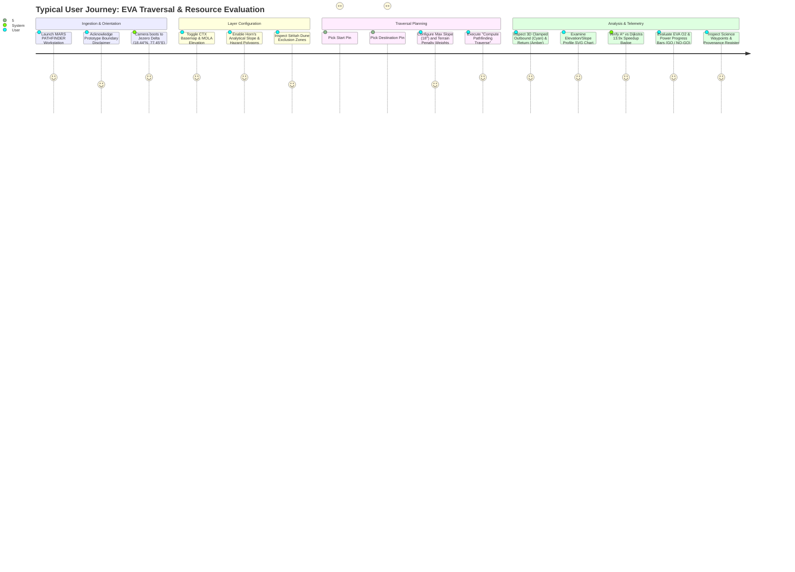
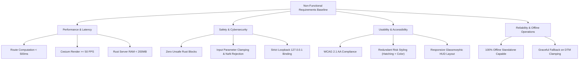

# MARS PATHFINDER — Product Requirements Document (PRD)

**Project Identifier:** MARS-PF-2026-PRD-001  
**Version:** 1.0.0  
**Challenge Track:** 2026 NASA Space Apps Challenge — *"Interplanetary Survival Guide: Martian Map"*  
**Pilot Geographic Focus:** Jezero Crater Western Delta, Mars ($\text{Lat: } 18.38^\circ\text{N} \text{ to } 18.52^\circ\text{N}$, $\text{Lon: } 77.38^\circ\text{E} \text{ to } 77.55^\circ\text{E}$)  
**Base Architecture:** Forked from `gods-eye-view` (Vue 3.5 + Pinia 2.3 + CesiumJS 1.124 + Vite 6.4)  
**Compute Engine:** Rust Microservice (`Axum` 0.7 + `Tokio` 1.38 + `Serde`)  
**Document Status:** Approved for Implementation Baseline  

---

## 1. Executive Summary & Problem Space

### 1.1 The Challenge: Interplanetary Mobility & Decision Support
Surface exploration of Mars presents unprecedented operational hazards. Astronauts on Extravehicular Activity (EVA) and autonomous planetary rovers encounter extreme geomorphic obstacles: steep impact crater scarps, unconsolidated dune fields (*Séítah* bedforms) prone to wheel entrapment, boulder-strewn debris aprons, and sharp elevation gradients.

Traditional planetary visualization tools are fragmented. Scientists and mission planners either rely on static orbital orthomosaics, non-interactive GIS shapefiles, or computationally heavy ground-control software unsuited for dynamic, real-time traversal evaluation. Crucially, existing cartographic applications frequently assume Earth geodesy (WGS84), producing up to an **87.8% scale distortion** when calculating Martian surface distances and slope angles.

### 1.2 Proposed Solution: MARS PATHFINDER
**MARS PATHFINDER** transforms the open-source `gods-eye-view` 3D geospatial engine into a high-fidelity, interactive 3D Martian decision-support console tailored specifically to the **Jezero Crater Western Delta** (the landing site and primary exploration corridor of NASA's Mars 2020 *Perseverance* rover).

By purging all Earth-centric OSINT layers and coordinate assumptions, MARS PATHFINDER establishes an end-to-end Martian operational platform featuring:
1. Native planetary rendering on the **Mars IAU 2015 Triaxial Ellipsoid (`IAU_2015:49900`)**.
2. Multi-layer streaming cartography integrating NASA Mars Trek WMTS mosaics with local high-resolution (1 m/px) Digital Terrain Models (DTM).
3. An ultra-fast, memory-safe **Rust `Axum` pathfinding microservice** computing 3D terrain-aware traversals using both $A^*$ and Dijkstra algorithms.
4. Asymmetric outbound and return route calculations accounting for uphill energetic penalties and slope hazard thresholds.
5. A hypothetical **EVA Consumables & Resource Estimator** modeling oxygen depletion, suit battery draw, and mandatory reserve policies.
6. A source-linked **Dataset Provenance & Uncertainty Register** tracking instrument origins, spatial resolutions, and data limitations.

### 1.3 Mandatory Product Boundary & Safety Disclaimer
To prevent operational misinterpretation, the following disclaimer is permanently integrated into the workstation header, onboarding briefing, and telemetry readouts:

> **CRITICAL OPERATIONAL NOTICE (PROTOTYPE BOUNDARY):**  
> *"MARS PATHFINDER is a research, educational, and decision-support prototype developed for the NASA Space Apps Challenge. It is NOT a flight-certified navigation system, an autonomous rover driving system, a real-time spacesuit telemetry monitor, a guarantee of astronaut safety, or a substitute for NASA Jet Propulsion Laboratory (JPL) Mission Control operations. All slope thresholds, traversability penalties, walking speeds, and EVA metabolic consumption rates represent configurable prototype models and must not be used for actual extraterrestrial mission command without flight qualification."*

---

## 2. Target Personas & User Scenarios

### 2.1 Primary Personas

| Persona | Role | Primary Objective | Key Pain Points Addressed |
| :--- | :--- | :--- | :--- |
| **Dr. Elena Vance** | Martian EVA Astronaut / Geologist | Plan and evaluate surface walking excursions from base camp to geological outcrops while remaining within strict life support margins. | Lacks integrated 3D awareness of steep crater scarps and cannot verify return oxygen reserves against uphill elevation gains. |
| **Marcus Cole** | Tactical Rover Navigation Engineer (JPL) | Validate optimal traverse pathways between scientific sampling waypoints while avoiding sand ripple entrapment. | Traditional straight-line planners ignore dune hazard polygons (*Séítah*) and require cumbersome manual slope verification. |
| **Dr. T. Davies** | Mission Science Lead (Mars 2020) | Correlate orbital mineralogy (CRISM carbonate signatures) with ground-truth sample depots (*Three Forks*). | Difficulty cross-referencing multi-spectral orbital detections with rover traverse paths and high-resolution DTM contours. |
| **Flight Dynamics Officer (FDO)** | Telemetry & Operations Support | Audit algorithmic performance ($A^*$ vs. Dijkstra) and verify geospatial data provenance across diverse orbital instruments. | Black-box routing engines provide no node-exploration proof, spatial uncertainty flags, or instrument error boundaries. |

### 2.2 Core Operational Scenarios

---

## 3. Geographic Pilot Boundary & Cartographic Standards

### 3.1 Spatial Bounding Box
MARS PATHFINDER focuses on the **Western Fan and Delta Region of Jezero Crater**:
* **Northern Latitude:** $18.5200^\circ\text{N}$
* **Southern Latitude:** $18.3800^\circ\text{N}$
* **Eastern Longitude:** $77.5500^\circ\text{E}$
* **Western Longitude:** $77.3800^\circ\text{E}$
* **Central Anchor Point:** $18.4447^\circ\text{N}, 77.4508^\circ\text{E}$ (Octavia E. Butler Landing Site)
* **High-Resolution DTM Pilot Sub-grid:** $\text{Lat} \in [18.4100^\circ, 18.4900^\circ]$, $\text{Lon} \in [77.4000^\circ, 77.5000^\circ]$

### 3.2 Planetary Geodesy & Reference Systems
All distance, area, and slope calculations must strictly adhere to the following planetary constants:
* **Planetary Body:** Mars (Fourth planet from the Sun)
* **Coordinate Reference System (CRS):** `IAU_2015:49900` (Planetocentric Latitude, East-Positive Longitude $[0^\circ, 360^\circ]$)
* **Equatorial Semi-Major Axis ($a$):** $3,396,190.0\text{ m}$
* **Polar Semi-Minor Axis ($b$):** $3,376,200.0\text{ m}$
* **Flattening Factor ($f$):** $\frac{a - b}{a} \approx 0.005886$
* **Vertical Datum (Areoid):** MOLA Mars Aeroid equipotential surface ($0\text{ m}$ elevation datum defined by average equatorial radius $3,396,000\text{ m}$)

---

## 4. Functional Requirements (MoSCoW Breakdown)

### 4.1 Must Have (P0 — Essential Mission Baseline)

#### FR-01: Mars IAU 2015 Geodesy & Ellipsoid Enforcement
* **Description:** The system must construct and operate CesiumJS using `MARS_ELLIPSOID` ($a=3396190\text{ m}, b=3376200\text{ m}$).
* **Acceptance Criteria:**
  1. `Cesium.Ellipsoid.default` is overridden with `MARS_ELLIPSOID` prior to Viewer initialization.
  2. Globe and sky atmosphere instances bind to `MARS_ELLIPSOID`.
  3. No references to `Cesium.Ellipsoid.WGS84` remain in raycasting, distance computation, or camera handlers.
  4. Camera initialization boots directly to Jezero Crater ($77.4508^\circ\text{E}, 18.4447^\circ\text{N}$, altitude $11,500\text{ m}$, heading $315^\circ$).

#### FR-02: Purge of Earth Bloat & Zero External Leaks
* **Description:** All Earth-specific OSINT layers, radio decoders, and background polling feeds must be eradicated.
* **Acceptance Criteria:**
  1. All 34 Earth layers in `src/app/catalog.js` and `src/standalone/data.js` are unregistered.
  2. WebUSB SDR controller initialization is disabled.
  3. Earth upstream polling proxies (`ais-live.js`, `opensky.js`, `wind.js`) in `server/standalone/vite.config.js` are stripped.
  4. Application boots with zero failed network requests to Earth endpoints.

#### FR-03: Multi-Layer Martian Basemap Stack
* **Description:** The frontend must provide independent visibility toggling and opacity sliders ($0\text{–}100\%$) for 6 distinct Martian layers.
* **Layers Managed:**
  1. `mars-basemap`: NASA Mars Trek WMTS Viking Global Mosaic ($232\text{ m/px}$) + CTX Jezero Orthophoto ($6\text{ m/px}$).
  2. `mars-elevation`: NASA Mars Trek MGS MOLA Elevation WMTS ($463\text{ m/px}$) colorized gradient.
  3. `mars-hillshade`: Horn's analytical grayscale hillshade raster overlay ($25\text{ m/px}$).
  4. `mars-slope`: Derived 3-class slope severity color ramp ($<10^\circ$ safe green, $10^\circ\text{–}\theta_{\max}$ amber, $>\theta_{\max}$ red hatch).
  5. `mars-hazards`: Mapped hazard polygons (Séítah dunes, boulder fields) + Coarse MOLA uncertainty boundary.
  6. `mars-science`: Interactive 3D pins for Perseverance milestones and CRISM carbonate targets.

#### FR-04: High-Resolution Jezero Digital Terrain Model (DTM) Engine
* **Description:** The backend Rust microservice must host a bounded $200 \times 200$ Jezero DTM elevation grid derived from HiRISE and HRSC stereo photogrammetry.
* **Acceptance Criteria:**
  1. Exposes `GET /api/mars/grid-summary` returning grid dimensions, bounding box, cell resolution ($\Delta x \approx 25\text{ m}, \Delta y \approx 24\text{ m}$), and elevation extrema ($-2568.4\text{ m}$ to $-2412.1\text{ m}$).
  2. Computes terrain gradients on-the-fly using Horn's $3\times3$ finite-difference convolution.
  3. Ingestion and slope compilation complete in $<50\text{ ms}$ upon server boot.

#### FR-05: Dual Algorithmic Pathfinding ($A^*$ vs. Dijkstra)
* **Description:** Pathfinding requests must execute across an 8-connected regular grid topology evaluating 3D Euclidean distances, uphill climbs, slopes, and mapped hazards.
* **Acceptance Criteria:**
  1. Computes both $A^*$ (using admissible 3D Euclidean distance heuristic) and Dijkstra (uniform-cost baseline).
  2. Enforces hard impassability for cells where $\text{slope} > \theta_{\max}$ or $\text{hazard} \ge 0.99$.
  3. Mathematically proves optimality: $A^*$ and Dijkstra must return the **exact same model cost** (within float epsilon $10^{-5}$) while $A^*$ expands substantially fewer nodes.
  4. Returns execution timing in microseconds ($\mu\text{s}$) and node exploration counts for both algorithms.

#### FR-06: Interactive Waypoint Selection & 3D Globe Picking
* **Description:** Users can define Start and Destination coordinates via preset waypoint dropdowns or direct 3D Cesium globe clicks.
* **Acceptance Criteria:**
  1. Clicking "Pick Start on Map" or "Pick Goal on Map" arms a `LEFT_CLICK` raycast handler.
  2. Raycasting against `MARS_ELLIPSOID` yields planetocentric lat/lon coordinates.
  3. Coordinates picked outside the high-resolution Jezero DTM boundary trigger an immediate visual warning toast.
  4. Markers are rendered in 3D at picked locations.

#### FR-07: Asymmetric Outbound & Return Route Visualization
* **Description:** Routes must be rendered on the 3D globe as clamped polylines with distinct visual styling.
* **Acceptance Criteria:**
  1. **Outbound Route:** Clamped polyline styled in glowing high-contrast Cyan (`#00f0ff`, width `5px`).
  2. **Return Route:** Clamped dashed polyline styled in Mars Amber/Gold (`#ffb703`, width `3px`).
  3. Due to the asymmetric uphill energy penalty factor $\alpha_{\text{uphill}}$, the return route must dynamically choose alternative descents when beneficial rather than mirroring the outbound leg.
  4. 3D markers are placed at Start, Destination, and the steepest traverse point.

#### FR-08: Interactive SVG Elevation & Slope Profile HUD
* **Description:** Cockpit view must render a dynamic elevation profile plotting elevation against cumulative distance.
* **Acceptance Criteria:**
  1. The SVG line graph is segmented and color-coded according to local slope angle.
  2. Hovering over any point on the SVG chart displays a tooltip with distance, elevation, slope, and uncertainty.
  3. Chart hover synchronously projects a 3D reticle onto the Cesium globe at the corresponding Martian coordinate.

---

### 4.2 Should Have (P1 — High-Value Operational Features)

#### FR-09: Hypothetical EVA Consumables & Resource Estimator
* **Description:** The system must compute mission duration, oxygen consumption, and suit battery energy draw against configurable astronaut limits.
* **Acceptance Criteria:**
  1. Inputs: Walking speed ($2.4\text{ km/h}$), science stop time ($30\text{ min}$), $\text{O}_2$ rate ($1.1\text{ L/min}$), suit power draw ($130\text{ Wh/hr}$).
  2. Evaluates total round-trip demand against a $550\text{ L}$ $\text{O}_2$ tank and $850\text{ Wh}$ battery.
  3. Enforces a mandatory $25\%$ safety reserve threshold.
  4. Displays a high-visibility status badge: **GO (Nominal)** if total consumption $\le 75\%$, or **NO-GO (Exceeds Reserve / Impassable)** if reserves are breached.

#### FR-10: Science Target & Hazard Inspector Card (Intel HUD)
* **Description:** Clicking any 3D entity on the globe opens an inspector card displaying comprehensive geological and operational metadata.
* **Acceptance Criteria:**
  1. Displays Feature Name, Classification (Science Target, Base Camp, Hard Hazard).
  2. Displays Discovery Mission, Instrument (Perseverance PIXL/SHERLOC, MRO HiRISE, CRISM), and Sol of acquisition.
  3. Displays Martian elevation, geological context, and an official clickable NASA PDS URL.

#### FR-11: Dataset Provenance & Spatial Uncertainty Register Modal
* **Description:** Dedicated modal presenting full metadata for all ingested datasets.
* **Acceptance Criteria:**
  1. Accessible via header button and layer panel link.
  2. Fetches `GET /api/mars/provenance` and renders structured table: Dataset Title, Instrument, Resolution, CRS, PDS Product ID, and Uncertainty Handling.

---

### 4.3 Could Have (P2 — Extended Enhancements)

#### FR-12: Multi-Criteria Traversal Weight Presets
* **Description:** Segmented quick-selection for routing strategies:
  * *Balanced:* $w_s=3.5, w_h=6.0, w_u=4.0$.
  * *Shortest Distance:* $w_s=0.5, w_h=1.0, w_u=1.0$.
  * *Minimum Risk / High Certainty:* $w_s=6.0, w_h=10.0, w_u=8.0$.

---

## 5. Non-Functional Requirements (NFR)

### 5.1 Performance & Scalability
* **NFR-01 (Pathfinding Latency):** Server-side route computation for a $200 \times 200$ grid ($40,000$ cells) must complete in under $500\text{ ms}$ (target $<50\text{ ms}$ for $A^*$).
* **NFR-02 (Rendering Framerate):** Cesium 3D globe draped with all 6 Mars layers must maintain a minimum of $50\text{ FPS}$ on standard mid-tier hardware (integrated GPU or better).
* **NFR-03 (Memory Footprint):** The Rust `mars-server` microservice must consume $<200\text{ MB}$ RSS memory during peak pathfinding operations. The frontend browser tab must not exceed $600\text{ MB}$ heap.

### 5.2 Precision & Scientific Rigor
* **NFR-04 (Geodetic Accuracy):** Geodesic distances must calculate using Mars IAU 2015 equatorial and polar axes. Deviations between grid cell distance formulas and exact ellipsoidal arc lengths must remain below $0.5\%$.
* **NFR-05 (Algorithmic Determinism):** Repeated routing queries with identical parameters must return identical coordinates, costs, and node counts across both $A^*$ and Dijkstra.

### 5.3 Cybersecurity & Safe Computing
* **NFR-06 (Input Sanitization):** All inputs to `POST /api/mars/route` must reject `NaN`, `+Infinity`, and `-Infinity`. Floating-point coordinates must be clamped to the allowable planetary ranges ($\text{Lat} \in [-90, 90]$, $\text{Lon} \in [-180, 360]$).
* **NFR-07 (Network Isolation):** The Rust microservice must bind exclusively to `127.0.0.1:8081`. No remote open sockets or unauthenticated external access points may be created.
* **NFR-08 (Zero External Dependencies):** The system must remain fully functional in air-gapped environments using local static basemaps and embedded DTM data.

### 5.4 Usability & Accessibility
* **NFR-09 (Colorblind Redundancy):** Hazards and steep slopes must never be communicated by color alone. Cross-hatch patterns, dashed polyline styles, and text badges must accompany all visual indicators.
* **NFR-10 (Glassmorphic Contrast):** All text elements must achieve a contrast ratio $\ge 4.5:1$ against the deep basalt glassmorphic background (`rgba(18, 14, 12, 0.86)`), satisfying WCAG 2.1 AA standards.

---

## 6. Assumptions, Risks & Mitigation Matrix

| Risk ID | Risk Description | Severity | Likelihood | Mitigation Strategy |
| :--- | :--- | :--- | :--- | :--- |
| **RSK-01** | User selects Start or Goal coordinate outside high-resolution Jezero DTM grid. | Medium | High | Clamping to grid boundary accompanied by a clear toast warning; fallback to coarse MOLA elevation lookup. |
| **RSK-02** | $A^*$ heuristic becomes inadmissible due to slope/uphill weighting, leading to suboptimal routes. | High | Low | Mathematical formulation guarantees step cost $\text{Cost}(u, v) \ge d_{\text{3D}}(u, v)$ everywhere since $\alpha_{\text{uphill}} \ge 1$ and weights $\ge 0$. Heuristic $h(v) = d_{\text{3D}}(v, \text{goal})$ is strictly admissible. Verified via continuous automated regression tests comparing $A^*$ cost against Dijkstra. |
| **RSK-03** | Route planner allows passage through impassable sand dunes or steep scarps. | Critical | Low | Hard exclusion barriers: cells with slope $>\theta_{\max}$ or hazard $\ge 0.99$ are assigned an infinite cost ($\infty$), guaranteeing exclusion from the open set. |
| **RSK-04** | Mars Trek WMTS tile server latency or rate limiting causes basemap dropout. | Medium | Medium | Local fallback imagery provided in `public/mars-data/`; Cesium tile cache holds pre-rendered tiles locally. |
| **RSK-05** | Browser WebGL context loss due to excessive 3D geometry or entity proxies. | High | Low | Adherence to Principle of Single Ownership; all entities managed via Cesium primitives or unproxied shallow snapshots (`shallowRef` / `markRaw`). |

---

## 7. Success & Acceptance Criteria

The MARS PATHFINDER system is deemed complete and verified when:
1. `cargo test` in `mars-server/` passes 100% of unit tests, validating Mars scale factors, hard slope exclusions, and $0.00\%$ cost deviation between $A^*$ and Dijkstra.
2. The CesiumJS globe renders Mars using `MARS_ELLIPSOID` with butterscotch atmospheric scattering and boots to Jezero Crater ($18.4447^\circ\text{N}, 77.4508^\circ\text{E}$).
3. A user can pick Start and Goal points anywhere within the Jezero pilot grid and compute an optimal round-trip traversal in $<500\text{ ms}$.
4. The Cockpit HUD renders the synchronized SVG elevation profile, $A^*$ speedup badge, and EVA Consumables progress bars.
5. Clicking science targets displays the Intel HUD with verified Mars 2020 Perseverance instrument metadata.
6. The Dataset Provenance Register modal renders complete PDS citation metadata for all 6 layers.
