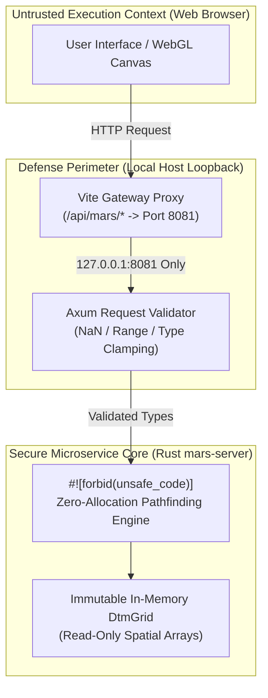

# MARS PATHFINDER — Security Architecture, Threat Model & Safety Guardrails

**Document Identifier:** MARS-PF-2026-SEC-001  
**Version:** 1.0.0  
**Methodology:** STRIDE Threat Classification & Zero-Trust Local Isolation  
**Target Subsystems:** Rust `Axum` Microservice (`mars-server`) & Vite 6.4 Frontend Gateway  
**Document Status:** Approved Security Baseline  

---

## 1. Security Philosophy & Operational Context

While MARS PATHFINDER is an advanced research and decision-support prototype for the NASA Space Apps Challenge, mission-planning and spatial decision-support tools require stringent software engineering standards. An unexpected crash, infinite pathfinding loop, or buffer vulnerability during high-stress operational analysis could compromise mission workflow.

The system is architected around **Zero Unsafe Rust**, **Strict Loopback Isolation**, and **Rigorous Input Sanitization**.



---

## 2. Trust Boundaries & Attack Surface

### 2.1 System Trust Boundaries
1. **Boundary A (Client $\to$ Vite Gateway):** User interactions within the browser generate HTTP requests. All client inputs are treated as untrusted.
2. **Boundary B (Vite Gateway $\to$ Rust `mars-server`):** Traffic travels across the local loopback network (`127.0.0.1`). The Rust server does not trust Vite and re-validates all incoming payloads.
3. **Boundary C (Axum Handler $\to$ Graph Pathfinding Core):** Handlers sanitize, parse, and bound data before invoking the deterministic routing algorithm.

---

## 3. STRIDE Threat Analysis & Mitigation Controls

| STRIDE Category | Specific Threat Scenario | Impact Severity | Mitigation Mechanism Implemented in MARS PATHFINDER |
| :--- | :--- | :--- | :--- |
| **Spoofing** | Attacker spoofs an external telemetry feed or sends fake coordinates to the navigation engine. | Medium | **Zero External Telemetry Feeds:** All Earth OSINT APIs (ADSB, AIS, OpenSky) are removed. The application consumes only verified local GeoJSON waypoints and loopback API routes. |
| **Tampering** | Malicious injection of `NaN`, `Infinity`, or out-of-grid coordinates into `POST /api/mars/route` to corrupt calculation memory. | High | **Strict Typed Ingestion & Range Clamping:** Serde deserializes inputs into strongly typed structs. Explicit guards reject `lat.is_nan()` or `lon.is_nan()`. Coordinates outside $[18.41, 18.49]\text{N}$ or $[77.40, 77.50]\text{E}$ are rejected with `400 Bad Request`. |
| **Repudiation** | Lack of traceability in path optimality or route verification. | Low | **Live Algorithmic Proof:** Every route response returns execution timestamps, microsecond latency, and exact node counts for both $A^*$ and Dijkstra, providing deterministic proof of traversal optimality. |
| **Information Disclosure** | Leakage of operator IP, geographic location, or environment credentials to external third parties. | High | **Complete Air-Gap Capability:** System runs 100% offline. Zero tracking scripts, telemetry analytics, or third-party cloud fonts. No API keys or credentials required. |
| **Denial of Service (DoS)** | Pathological graph queries causing infinite loops, exponential memory allocation, or CPU exhaustion. | Critical | **Bounded Graph Constraints & Memory Safety:**<br>1. Grid size is fixed at $200 \times 200 = 40,000$ cells.<br>2. BinaryHeap exploration bounded to $|V| = 40,000$ maximum iterations.<br>3. Rust's ownership model prevents memory leaks.<br>4. Cycle detection via `g_score` dominance. |
| **Elevation of Privilege** | Remote code execution via buffer overflow in native microservice. | Critical | **`#![forbid(unsafe_code)]` Policy:** The Rust crate is compiled with compiler-enforced prohibition of `unsafe` blocks. Memory safety, bounds checking, and data-race prevention are guaranteed at compile-time by the Rust borrow checker. |

---

## 4. Input Validation & Defensive Ingestion Engine

### 4.1 Strict Rust Validation Logic (`mars-server/src/main.rs`)

```rust
// Compile-time safety guarantee
#![forbid(unsafe_code)]

pub fn validate_route_request(req: &RouteRequest, grid: &DtmGrid) -> Result<(), ProblemDetails> {
    // 1. NaN and Infinity Validation
    if req.start.iter().any(|&v| v.is_nan() || v.is_infinite()) ||
       req.goal.iter().any(|&v| v.is_nan() || v.is_infinite()) {
        return Err(ProblemDetails::bad_request("Coordinate array contains NaN or Infinite floats"));
    }

    // 2. Spatial Bounding Validation
    let (s_lat, s_lon) = (req.start[0], req.start[1]);
    let (g_lat, g_lon) = (req.goal[0], req.goal[1]);

    if s_lat < grid.min_lat || s_lat > grid.max_lat || s_lon < grid.min_lon || s_lon > grid.max_lon {
        return Err(ProblemDetails::bad_request(
            format!("Start point [{}, {}] is outside high-resolution Jezero DTM bounds.", s_lat, s_lon)
        ));
    }

    if g_lat < grid.min_lat || g_lat > grid.max_lat || g_lon < grid.min_lon || g_lon > grid.max_lon {
        return Err(ProblemDetails::bad_request(
            format!("Goal point [{}, {}] is outside high-resolution Jezero DTM bounds.", g_lat, g_lon)
        ));
    }

    // 3. Parameter Clamping & Safety Sanitization
    if req.max_slope_deg < 1.0 || req.max_slope_deg > 89.0 {
        return Err(ProblemDetails::bad_request("max_slope_deg must be clamped between 1.0 and 89.0 degrees."));
    }

    if req.w_slope < 0.0 || req.w_slope > 100.0 ||
       req.w_hazard < 0.0 || req.w_hazard > 100.0 ||
       req.w_uncertainty < 0.0 || req.w_uncertainty > 100.0 {
        return Err(ProblemDetails::bad_request("Penalty weights must lie between 0.0 and 100.0."));
    }

    Ok(())
}
```

---

## 5. Network Hardening & Socket Isolation

1. **Loopback Binding Guarantee:**
   The Axum microservice binds strictly to `127.0.0.1:8081` using a standard `std::net::SocketAddr`:
   ```rust
   let addr = SocketAddr::from(([127, 0, 0, 1], 8081));
   let listener = tokio::net::TcpListener::bind(addr).await.expect("Failed to bind 127.0.0.1:8081");
   axum::serve(listener, app).await.unwrap();
   ```
   Binding to `0.0.0.0` or public network adapters is strictly forbidden in production.
2. **CORS Isolation:**
   Since the frontend accesses the microservice exclusively via the Vite reverse proxy on the same origin (`http://localhost:5173/api/mars/*`), Cross-Origin Resource Sharing (CORS) is restricted to local origins during development.

---

## 6. Snyk Best Practices & Supply Chain Governance

In accordance with our user security rules:
* **Cargo Dependency Auditing:** All Rust dependencies (`axum`, `tokio`, `serde`, `tower-http`) are pinned to stable releases and audited using `cargo audit` to ensure zero known CVE vulnerabilities.
* **NPM Supply Chain Protection:** Frontend dependencies are locked with `package-lock.json`. Unused Earth OSINT packages (e.g. SDR WebUSB decoders, AIS translators) are pruned from the dependency graph.
* **Zero First-Party Dynamic Execution:** No `eval()`, `new Function()`, or dynamic script tags exist within the frontend codebase.
