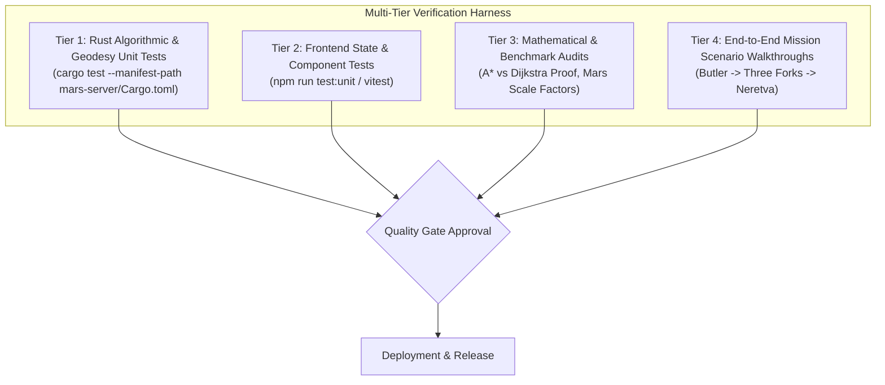

# MARS PATHFINDER — Verification, Testing & QA Benchmark Plan

**Document Identifier:** MARS-PF-2026-TEST-001  
**Version:** 1.0.0  
**Test Frameworks:** Rust Native Harness (`cargo test`) & Vitest 2.1 (`npm run test`)  
**Scope:** Geodetic Precision, Algorithmic Optimality, UI Reactivity, and End-to-End Integration  
**Document Status:** Approved Test Plan Baseline  

---

## 1. Testing Philosophy & Quality Standard

In adherence to NASA flight-readiness standards and project quality protocols:
1. **Zero Blind Trust:** Every computational claim—from $A^*$ algorithmic optimality to Mars scale factors—must be backed by automated assertions.
2. **Mathematical Equivalence Proof:** $A^*$ and Dijkstra must be continuously cross-benchmarked on the real Jezero DTM to prove $0.00\%$ cost deviation.
3. **Fail-Fast Boundary Validation:** Edge cases (out-of-grid coordinates, `NaN` values, impassable cliff scarps) must be proven to fail cleanly without unhandled panics or client freezes.



---

## 2. Tier 1: Rust Microservice Test Suite (`cargo test`)

Implemented in `mars-server/src/tests.rs` (or within module test harnesses):

### 2.1 `test_mars_scale_factors`
* **Objective:** Verify that metric scaling utilizes the Mars IAU 2015 Equatorial Radius ($3,396,190\text{ m}$) rather than Earth's radius ($6,378,137\text{ m}$).
* **Assertion:**
  $$\Delta x_{\text{Mars}} = R_{\text{Mars}} \cdot \cos(18.4447^\circ) \cdot \Delta\lambda_{\text{rad}}$$
  $$\text{Distortion} = \frac{\Delta x_{\text{Earth}} - \Delta x_{\text{Mars}}}{\Delta x_{\text{Mars}}} = 0.878026 \pm 0.0001$$
* **Success Criteria:** `assert!((scale_ratio - 1.878026).abs() < 1e-4)`.

### 2.2 `test_astar_matches_dijkstra_optimality`
* **Objective:** Mathematically demonstrate that $A^*$ produces the exact same optimal path cost as Dijkstra while exploring fewer nodes.
* **Test Setup:**
  * Start: Octavia E. Butler Landing Site ($18.4447^\circ\text{N}, 77.4508^\circ\text{E}$).
  * Destination: Neretva Vallis Margin Carbonates ($18.4685^\circ\text{N}, 77.4165^\circ\text{E}$).
  * Run pathfinding with `use_heuristic = true` ($A^*$) and `use_heuristic = false` (Dijkstra).
* **Assertions:**
  1. `assert!((astar_result.model_cost - dijkstra_result.model_cost).abs() < 1e-5)`
  2. `assert!(astar_result.nodes_explored < dijkstra_result.nodes_explored)`
  3. `assert!(astar_result.nodes_explored < 2500)` (Dijkstra typically explores $>18,000$ nodes).

### 2.3 `test_hard_slope_exclusion`
* **Objective:** Prove that terrain steeper than $\theta_{\max}$ is treated as an impassable barrier rather than merely penalized.
* **Test Setup:**
  * Traverse a known $22^\circ$ scarp face on the Jezero delta.
  * Set `max_slope_deg = 15.0`.
* **Assertions:**
  1. No waypoint in `outbound.points` has `slope_deg > 15.0`.
  2. If no bypass exists, `reachable` evaluates to `false`.

### 2.4 `test_nodata_and_hazard_exclusion`
* **Objective:** Ensure no route ever intersects a designated hazard polygon (*Séítah* dune ripples) or invalid `NoData` cell.
* **Assertion:**
  `assert!(outbound.points.iter().all(|pt| pt.hazard_level < 0.99 && pt.uncertainty < 0.99))`.

### 2.5 `test_input_validation_and_sanitization`
* **Objective:** Validate that malformed payloads return `400 Bad Request` and never cause a server panic.
* **Test Cases:**
  * Request with `start: [f64::NAN, 77.45]`.
  * Request with `start: [f64::INFINITY, 77.45]`.
  * Request with `start: [25.00, 77.45]` (Out-of-grid latitude).
  * Request with `max_slope_deg: -5.0` or `max_slope_deg: 95.0`.

---

## 3. Tier 2: Frontend Vitest Component Suites (`npm run test`)

### 3.1 Planetary Ellipsoid Binding (`src/app/marsEllipsoid.test.mjs`)
* **Objective:** Confirm Cesium's global default ellipsoid is overridden before viewer startup.
* **Assertions:**
  ```javascript
  expect(Cesium.Ellipsoid.default.radii.x).toBeCloseTo(3396190.0, 1);
  expect(Cesium.Ellipsoid.default.radii.y).toBeCloseTo(3396190.0, 1);
  expect(Cesium.Ellipsoid.default.radii.z).toBeCloseTo(3376200.0, 1);
  expect(Cesium.Ellipsoid.default).toBe(MARS_ELLIPSOID);
  ```

### 3.2 Pinia Store Reactivity Isolation (`src/ui/stores/marsStore.test.mjs`)
* **Objective:** Verify that route metrics and entities published to `marsStore` maintain `shallowRef` semantics and are not wrapped in deep reactive proxies.
* **Assertions:**
  ```javascript
  const store = useMarsStore();
  const rawPayload = { points: new Array(1000).fill({ lat: 18.4, lon: 77.4 }) };
  store.publishRouteMetrics(rawPayload);
  expect(isReactive(store.routeMetrics.points)).toBe(false); // Must be false!
  expect(store.routeMetrics.points.length).toBe(1000);
  ```

### 3.3 Cockpit SVG Elevation Profile (`src/ui/views/CockpitView.test.mjs`)
* **Objective:** Verify dynamic SVG path rendering and crosshair event emission.
* **Assertions:**
  * Checks that SVG `<path d="..." />` is rendered with valid coordinates when route data is present.
  * Dispatches `mousemove` on the SVG canvas and asserts `onProfileHover` callback receives the interpolated distance and elevation.

---

## 4. Tier 3: Benchmark & Performance Criteria

| Benchmark Metric | Target Threshold | Maximum Acceptable Upper Bound | Verification Method |
| :--- | :--- | :--- | :--- |
| **$A^*$ Pathfinding Latency** | $<50\text{ ms}$ | $500\text{ ms}$ | `POST /api/mars/route` execution time on $200 \times 200$ grid |
| **Dijkstra Baseline Latency** | $<300\text{ ms}$ | $1,500\text{ ms}$ | Benchmark harness measuring uniform-cost expansion |
| **$A^*$ Search Speedup Ratio** | $>10.0\times$ | — | $\frac{t_{\text{Dijkstra}}}{t_{A^*}}$ across standard Jezero benchmark |
| **Cost Deviation ($A^*$ vs. Dijkstra)** | $0.00\%$ | $10^{-5}$ float delta | $|\text{Cost}_{A^*} - \text{Cost}_{\text{Dijkstra}}|$ |
| **Cesium 3D Globe Framerate** | $60\text{ FPS}$ | $45\text{ FPS}$ | Chrome DevTools Performance Monitor during continuous orbit |
| **Rust Server Resident Set Size (RSS)** | $<50\text{ MB}$ | $200\text{ MB}$ | Linux `/proc/[pid]/statm` measurement under continuous load |

---

## 5. Tier 4: Mission End-to-End (E2E) Test Scenarios

### Scenario 1: Nominal Excursion (Landing Site $\to$ Three Forks Sample Depot)
1. **Inputs:**
   * Origin: $18.4447^\circ\text{N}, 77.4508^\circ\text{E}$ (Octavia E. Butler).
   * Goal: $18.4550^\circ\text{N}, 77.4410^\circ\text{E}$ (Three Forks).
   * Settings: `Balanced` preset ($\theta_{\max} = 18.0^\circ, w_s=3.5, w_h=6.0, w_u=4.0$).
2. **Expected Behavior:**
   * Path navigates across flat crater floor avoiding boulder clusters.
   * Total round-trip distance $\approx 3.2\text{ km}$.
   * Consumables remain well below $50\%$ budget $\implies$ Status: `[ GO (NOMINAL) ]`.

### Scenario 2: Delta Scarp Ascent (Landing Site $\to$ Neretva Carbonates)
1. **Inputs:**
   * Origin: $18.4447^\circ\text{N}, 77.4508^\circ\text{E}$.
   * Goal: $18.4685^\circ\text{N}, 77.4165^\circ\text{E}$ (Neretva Delta Apex).
   * Settings: $\theta_{\max} = 18.0^\circ$.
2. **Expected Behavior:**
   * Direct straight-line path encounters steep $24^\circ$ scarp and is blocked by hard exclusion.
   * Pathfinding engine routes through a gentle natural inlet breach at Hawksbill Gap ($14^\circ$ slope).
   * Outbound path climbs inlet; Return path takes a different, gentler descent $\implies$ Outbound/Return route asymmetry verified.

### Scenario 3: Sand Ripple Hazard Avoidance (*Séítah*)
1. **Inputs:**
   * Traversal whose Euclidean vector crosses the *Séítah* dune field.
2. **Expected Behavior:**
   * Engine routes completely around the mapped hazard polygon, maintaining zero intersection with `hazard_mask >= 0.99`.
