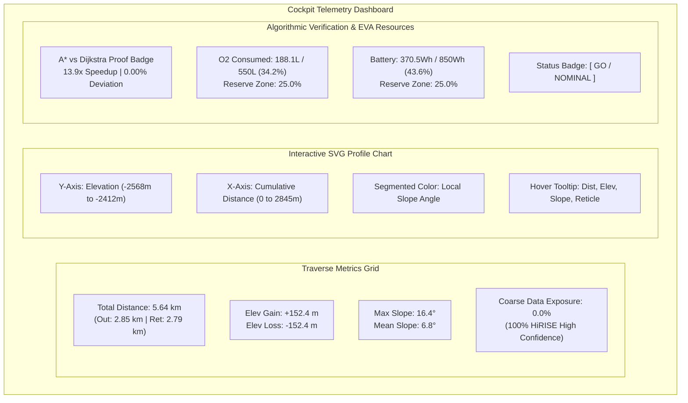

# MARS PATHFINDER — UI / UX Specification & Design System Improvements

**Document Identifier:** MARS-PF-2026-UI-001  
**Version:** 1.0.0  
**Design Persona:** NASA JPL Mars 2020 / Jezero Surface Operations Workstation  
**Design Foundations:** Glassmorphic Martian Basalt (`rgba(18, 14, 12, 0.86)`), High-Contrast Mission Amber (`#ff6b35`), Telemetry Cyan (`#00f0ff`)  
**Accessibility Target:** WCAG 2.1 AA (Full Redundant Encoding for Colorblind Safety)  
**Document Status:** Approved UI Baseline  

---

## 1. Design Vision & Aesthetic Transformation

### 1.1 Transitioning from Earth OSINT to JPL Mission Control
The base repository `gods-eye-view` features a sleek, military-grade Earth intelligence HUD. To transition into **MARS PATHFINDER**, the entire visual identity is transformed from "Earth Tactical Surveillance" into an **authentic, high-contrast NASA JPL planetary operations workstation**.

```mermaid
graph LR
    subgraph Legacy_Theme ["Legacy gods-eye-view (Earth OSINT)"]
        L1["Military Olive & Gunmetal (#1a202c)"]
        L2["Earth WGS84 Blue Skies & Oceans"]
        L3["34 Earth OSINT Feed Toggles (ADSB/AIS/CCTV)"]
        L4["Tactical Reconnaissance Terminology"]
    end

    subgraph Mars_Pathfinder_Theme ["MARS PATHFINDER (JPL Mission Ops)"]
        M1["Deep Martian Basalt Glass (#120e0c / 86% Alpha)"]
        M2["Martian Butterscotch Sky & Ochre Terrain"]
        M3["6 Planetary GIS Layers (MOLA/CTX/DTM/Slope/Hazards)"]
        M4["Scientific & EVA Telemetry Terminology"]
    end

    Legacy_Theme ==>|Comprehensive Overhaul| Mars_Pathfinder_Theme
```



### 1.2 Core Design Principles
1. **Mission-Critical Information Density:** Data is presented cleanly without superfluous decorative widgets or "AI slop". Monospace metrics are paired with visual indicators for rapid cognitive evaluation.
2. **Redundant Risk Communication:** Slope severity, traversability, and hazard zones are **never communicated by color alone**. All visual risks combine color ramps, distinctive stroke textures (solid vs. dashed vs. cross-hatched), and explicit semantic text labels.
3. **Spatial-Temporal Synchronization:** Hovering interactive 2D charts (e.g., SVG elevation profiles) immediately projects synchronized 3D targeting reticles onto the Martian globe, maintaining spatial awareness.
4. **Mandatory Safety Visibility:** The prototype decision-support disclaimer is permanently accessible and prominently displayed during onboarding.

---

## 2. Design System Tokens & Color Architecture

### 2.1 CSS Custom Properties (`src/ui/styles/marsTheme.css`)

```css
:root {
  /* =========================================================================
     MARTIAN PALETTE TOKENS
     ========================================================================= */
  --bg-space: #070504;
  --bg-panel: rgba(18, 14, 12, 0.86);
  --bg-panel-hover: rgba(28, 22, 19, 0.92);
  --bg-panel-solid: #15110f;
  
  --border-panel: rgba(255, 107, 53, 0.22);
  --border-panel-focused: rgba(255, 107, 53, 0.65);
  --border-subtle: rgba(255, 255, 255, 0.08);

  /* Primary Brand & Accents */
  --accent-primary: #ff6b35;          /* Mars Mission Amber / Orange */
  --accent-primary-glow: rgba(255, 107, 53, 0.40);
  --accent-secondary: #e0531e;
  --accent-highlight: #ffa07a;

  /* Traverse & Route Telemetry */
  --route-outbound: #00f0ff;          /* High-Contrast EVA Cyan */
  --route-outbound-glow: rgba(0, 240, 255, 0.50);
  --route-return: #ffb703;            /* Return Leg Gold */
  --route-return-glow: rgba(255, 183, 3, 0.45);

  /* Operational Status & Safety */
  --status-nominal: #10b981;          /* Emerald GO / Passable */
  --status-caution: #f59e0b;          /* Amber Caution / Moderate Slope */
  --status-hazard: #ef4444;           /* Crimson NO-GO / Hard Exclusion */
  --status-uncertainty: #a855f7;      /* Violet Coarse MOLA Uncertainty */

  /* Text & Readouts */
  --text-primary: #f5f3f0;
  --text-secondary: #c5beba;
  --text-muted: #8c827a;
  --text-inverse: #070504;

  /* Typography Scales */
  --font-sans: 'Inter', -apple-system, BlinkMacSystemFont, 'Segoe UI', Roboto, sans-serif;
  --font-mono: 'JetBrains Mono', 'SF Mono', Consolas, Menlo, monospace;
  
  /* Shadows & Backdrop Filters */
  --backdrop-blur: blur(14px);
  --panel-shadow: 0 16px 36px rgba(0, 0, 0, 0.60), 0 0 0 1px var(--border-panel);
}
```

### 2.2 Semantic Color Mapping & Redundant Encoding

| Semantic Token | Hex Code | Primary Purpose | Redundant Texture / Icon Pattern | Accessible Text Label |
| :--- | :--- | :--- | :--- | :--- |
| `Safe Terrain` | `#10b981` | Slopes $<10^\circ$, clear bedrock | Solid line / Uniform tint | `NOMINAL (<10°)` |
| `Caution Terrain` | `#f59e0b` | Slopes $10^\circ\text{–}\theta_{\max}$, minor rubble | Dotted line / Diagonal striping | `CAUTION (10°-18°)` |
| `Hard Exclusion` | `#ef4444` | Slopes $>\theta_{\max}$, *Séítah* dunes | Cross-hatch pattern / Crimson border | `IMPASSABLE / HARD EXCLUSION` |
| `Coarse Data Zone` | `#a855f7` | MOLA $463\text{ m/px}$ uncertainty | Wide chevron hatch / Dashed perimeter | `COARSE MOLA (UNCERTAIN)` |
| `Outbound Route` | `#00f0ff` | Outbound traverse track | Solid $5\text{px}$ line + Glowing pulse | `OUTBOUND TRAVERSE` |
| `Return Route` | `#ffb703` | Return traverse track | Alternating $8\text{px}/4\text{px}$ dash pattern | `RETURN TRAVERSE` |

---

## 3. Workstation HUD Information Architecture

The viewport is organized into a modular HUD layout that maximizes 3D globe visibility while placing critical telemetry, navigation controls, and layer configurations within immediate reach.

```text
+------------------------------------------------------------------------------------------------------+
| [MARS PATHFINDER // JEZERO PILOT]   LAT 18.4447°N | LON 77.4508°E | ALT 11.5KM   [RESET] [DATA] [DISCLAIMER] |
+------------------------------------------------------------------------------------------------------+
|  +--------------------+                                                      +---------------------+  |
|  | LAYER STACK (6)    |                                                      | INTEL HUD (INSPECT) |  |
|  | [x] Basemap  100%  |                                                      | Octavia E. Butler   |  |
|  | [x] Elevation 75%  |                                                      | Sample Depot        |  |
|  | [x] Hillshade 60%  |                                                      | Sol 1 - M2020       |  |
|  | [x] Slopes    85%  |                                                      | Elev: -2564.2m      |  |
|  | [x] Hazards  100%  |                                                      | [NASA PDS Link ->]  |  |
|  | [x] Science  100%  |                                                      +---------------------+  |
|  | [Provenance Modal] |                                                                               |
|  +--------------------+                                                                               |
|                                                                                                       |
|                                        [ 3D CESIUM MARS GLOBE ]                                       |
|                                   (Outbound Cyan / Return Gold Clamped)                              |
|                                                                                                       |
|  +-------------------------------------------------------------------------------------------------+  |
|  | COMMAND DOCK                                                                                    |  |
|  | Start: [Butler Landing [v]] [Pick]  Goal: [Neretva Delta [v]] [Pick]  Mode: [Balanced] [Short]  |  |
|  | Max Slope: [==|====] 18°   w_slope: 3.5   w_hazard: 6.0   w_uncert: 4.0   [COMPUTE TRAVERSE]   |  |
|  +-------------------------------------------------------------------------------------------------+  |
|  | COCKPIT TELEMETRY & PROFILE                                                                     |  |
|  | Dist: 5.64km | Gain: +152m | Max Slope: 16.4° | Uncert: 0% | A* 13.9x Speedup [OPTIMAL VERIFIED]   |  |
|  | [SVG ELEVATION & SLOPE PROFILE WITH DYNAMIC RETICLE SYNC HOVER]                                |  |
|  | O2: [████████████░░░░] 34% / 550L   Battery: [██████████████░░░] 44% / 850Wh   Status: [ GO ]   |  |
|  +-------------------------------------------------------------------------------------------------+  |
+------------------------------------------------------------------------------------------------------+
```

---

## 4. View-by-View Specifications & Wireframe Layouts

### 4.1 Header Bar (`SceneChromeView.vue`)
The top chrome provides persistent global mission status, camera orientation, and high-priority modals:
* **Left Section:**
  * Application Badge: `MARS PATHFINDER` in bold uppercase.
  * System Subtitle: `JEZERO CRATER DELTA PILOT // IAU_2015:49900`.
* **Center Section (Telemetry Ticker):**
  * Dynamic crosshair coordinates tracking the current mouse hover on Mars:
    `LAT: 18.4447°N | LON: 77.4508°E | ELEV: -2,564 M | RADIUS: 3,396.19 KM`.
* **Right Section (Quick Actions):**
  * `[Fly to Jezero Delta]`: Resets camera to standard northwest viewing angle.
  * `[Dataset Provenance]`: Opens the Section 4 Dataset Register modal.
  * `[Prototype Disclaimer]`: Displays the mandatory safety boundary notice.

### 4.2 Layer Management Panel (`LayerPanelsView.vue`)
Located on the top-left rail, this panel allows explorers to manipulate the 6 Martian cartographic feeds:
* **Layer Card Controls:**
  * Master Checkbox (Show / Hide).
  * Layer Name & Instrument Badge (`CTX 6m`, `MOLA 463m`, `HiRISE 1m`).
  * Continuous Opacity Slider ($0\text{–}100\%$) with numerical readout.
* **Integrated Dynamic Legend:**
  * Slope Legend: Safe Green ($<10^\circ$), Caution Amber ($10^\circ\text{–}18^\circ$), Steep Red Cross-Hatch ($>18^\circ$).
  * Hazards Legend: Sand Ripple Hatch (*Séítah*), Boulder Dot Grid, MOLA Coarse Boundary.
* **Footer CTA:**
  * `[ℹ️ Dataset Provenance & Limitations]`: Launches the comprehensive data provenance table.

### 4.3 Mission Command Dock (`CommandDockView.vue`)
Located along the lower viewport, the Command Dock serves as the primary route configuration console:
* **Waypoint Configuration:**
  * **Start (`A`):** Dropdown selector populated with official Jezero features (e.g., *Octavia E. Butler Landing*, *Three Forks*, *Hawksbill Gap*) + `[📍 Pick on Map]` button.
  * **Destination (`B`):** Dropdown selector + `[🎯 Pick on Map]` button.
* **3D Globe Picking State:**
  * When a pick button is clicked, the button pulses amber (`#ff6b35`), the cursor changes to a crosshair reticle, and a notification banner appears: *"Click anywhere within the Jezero pilot grid to set coordinate."*
  * Clicking outside the boundary ($18.41^\circ\text{N}\text{–}18.49^\circ\text{N}$, $77.40^\circ\text{E}\text{–}77.50^\circ\text{E}$) generates an immediate warning toast and rejects/clamps the selection.
* **Preset Selector (`UiSegmented`):**
  * `Balanced` ($w_s=3.5, w_h=6.0, w_u=4.0$).
  * `Shortest Distance` ($w_s=0.5, w_h=1.0, w_u=1.0$).
  * `Minimum Risk` ($w_s=6.0, w_h=10.0, w_u=8.0$).
* **Parameter Sliders (`UiSlider`):**
  * Max Passable Slope $\theta_{\max}$: $8^\circ\text{ to }30^\circ$ (Step: $1^\circ$).
  * Slope Penalty Weight $w_s$: $0.0\text{ to }10.0$ (Step: $0.5$).
  * Hazard Penalty Weight $w_h$: $0.0\text{ to }10.0$ (Step: $0.5$).
  * Uncertainty Weight $w_u$: $0.0\text{ to }10.0$ (Step: $0.5$).
* **Primary Traversal Trigger:**
  * Button: `[🚀 COMPUTE PATHFINDING TRAVERSE]` with hover glow and loading spinner. Hotkey: `Ctrl + Enter`.

### 4.4 Telemetry Cockpit & Profile Chart (`CockpitView.vue`)
Expanding from the bottom HUD, the Cockpit presents full mathematical proof and telemetry:



* **Interactive SVG Profile Features:**
  * Rendered using native SVG vector paths for crisp scaling on 4K displays.
  * The stroke is dynamically split into colored gradient segments according to local slope ($<10^\circ$ green, $10^\circ\text{–}18^\circ$ amber, $>18^\circ$ red).
  * Scrubbing along the profile highlights the corresponding point with a vertical hairline and projects an animated 3D sphere marker directly onto the Cesium Mars surface.
* **Algorithmic Verification Badge:**
  * Displays: *"Optimal Cost Verified: $A^*$ explored **1,420 nodes** ($380\text{ }\mu\text{s}$) vs. Dijkstra's **19,840 nodes** ($2,910\text{ }\mu\text{s}$) — $13.9\times$ speedup, $0.00\%$ cost deviation."*
* **EVA Resource Gauges:**
  * Dual horizontal stacked progress bars:
    * Used Budget (Cyan/Gold).
    * Available Usable Margin (Dark Green).
    * Mandatory $25\%$ Emergency Reserve (Hatched Amber/Red).
  * Status Pill:
    * `[ ✓ GO (NOMINAL) ]` in bright green when total usage $\le 75\%$.
    * `[ ⚠ NO-GO (RESERVE BREACH) ]` in flashing crimson when total usage $> 75\%$.

### 4.5 Intel Inspector Card (`IntelHudView.vue`)
Floats on the upper-right corner whenever a science target or hazard zone is selected:
* **Header:** Entity Name (e.g., `Octavia E. Butler Landing Site`) + Classification Badge (`SCIENCE TARGET`).
* **Attributes Grid:**
  * **Mission:** NASA Mars 2020 *Perseverance*.
  * **Payload Instruments:** `PIXL`, `SHERLOC`, `SuperCam`, `Mastcam-Z`.
  * **Sol of Arrival:** `Sol 1` (Feb 18, 2021).
  * **Elevation:** `-2,564.2 m` (MOLA Aeroid).
  * **Geological Context:** Deltaic bottomset beds, fine-grained mudstones with high preservation potential for biosignatures.
* **Direct Citation Link:**
  * External link button: `[Open NASA PDS Mars 2020 Data Archive ↗]` (target `_blank`, secure rel).

### 4.6 Onboarding & Safety Boundary Modal (`WelcomeView.vue`)
Presented on first launch or when the disclaimer action is clicked:
* **Header:** High-resolution Mars 2020 mission insignia + `MARS PATHFINDER DECISION SUPPORT SYSTEM`.
* **Briefing Text:** Contextual introduction explaining the Jezero Crater Western Delta mission scenario.
* **Framed Critical Notice Box:** Highlighting the mandatory research prototype disclaimer in bold amber text.
* **Acknowledge CTA:** `[ACKNOWLEDGE & ENTER MISSION WORKSTATION]` button with keyboard shortcut (`Space`).

---

## 5. Accessibility & Usability Standards (WCAG 2.1 AA)

1. **Colorblind Independence:**
   * All critical states (Safe, Caution, Danger, Uncertain) use dual-channel coding: color + textural pattern (dots, dashes, diagonal hatch) + explicit textual badges.
2. **Contrast Ratios:**
   * Text on basalt glass panels maintains a minimum contrast ratio of $4.8:1$ for body copy and $7.2:1$ for telemetry readouts.
3. **Keyboard Navigation:**
   * `Tab` traverses all interactive controls in a logical reading order.
   * `Enter` / `Space` activates buttons and segmented chips.
   * `Escape` closes any open modal (Provenance, Welcome, Intel card) and cancels active map picking mode.
   * `Ctrl + Enter` triggers route computation from any slider or input focus.
4. **Focus Rings:**
   * All focusable components display a high-visibility $2\text{px}$ solid amber focus outline (`--border-panel-focused`) with a $2\text{px}$ offset.
